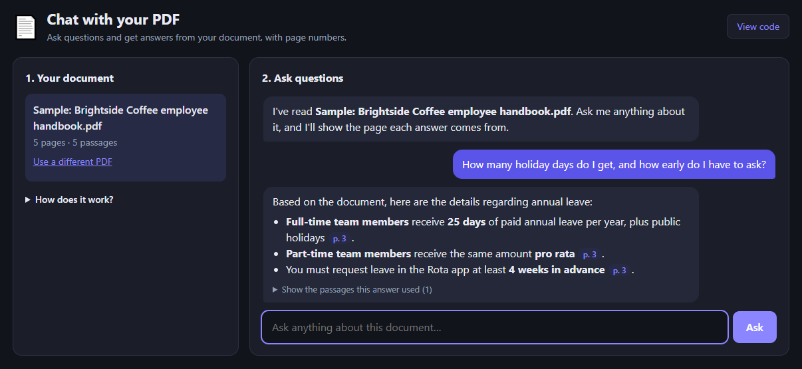

# 📄 Chat with your PDF

Upload a PDF and ask it questions. The AI answers **only from your document** and shows the **page number** for every fact, so you can check each answer.

**Live demo:** https://chat-with-pdf-mauve.vercel.app · Try it with the built-in sample handbook, no PDF needed.



## Features

- **Upload any text PDF** (drag and drop, up to 20 MB) or try the sample document
- **Answers with page citations.** Click a page chip to see the exact passage used
- **Honest answers:** if the document doesn't say it, the AI replies "I couldn't find that in this document" instead of guessing
- **Hybrid search:** combines meaning-based search (embeddings) with keyword search (BM25) for better results
- **Follow-up questions** remember the last few messages of the conversation
- **Private by design:** the PDF is read in your browser and never stored on the server
- Works on phones, with light and dark mode

## How it works (RAG)

This is a **Retrieval-Augmented Generation (RAG)** system:

1. **Read:** the browser extracts the text from each page with [pdf.js](https://mozilla.github.io/pdf.js/).
2. **Chunk:** the text is split into ~1,000-character passages (with overlap), each tagged with its page number.
3. **Embed:** each passage is turned into a 768-number vector with Google's `gemini-embedding-001` model.
4. **Retrieve:** for each question, passages are ranked by cosine similarity *and* BM25 keyword score, and the two rankings are merged with Reciprocal Rank Fusion. The top 6 are picked.
5. **Generate:** Gemini answers using only those passages and cites the pages.

```
PDF ─► pdf.js text ─► chunks ─► /api/embed ─► vectors (kept in the browser)
                                                  │
question ─► /api/embed ─► hybrid search ─► top passages ─► /api/ask ─► answer + [p. N]
```

## Tech stack

| Part | Technology |
|---|---|
| Backend | Python, FastAPI |
| AI | Google Gemini (free tier): `gemini-embedding-001` + `gemini-flash-lite-latest` |
| Search | Cosine similarity + BM25, merged with Reciprocal Rank Fusion |
| Frontend | HTML, CSS, JavaScript, pdf.js |
| Hosting | Vercel |

## Run it on your computer

1. Get a free Gemini API key at https://aistudio.google.com/apikey
2. In a terminal:
   ```bash
   git clone https://github.com/imumaimabukhari-123/chat-with-pdf.git
   cd chat-with-pdf
   python -m venv venv
   venv\Scripts\activate          # on Mac/Linux: source venv/bin/activate
   pip install -r requirements.txt
   copy .env.example .env         # on Mac/Linux: cp .env.example .env
   ```
3. Open `.env` and paste your key after `GEMINI_API_KEY=`.
4. Run `python app.py` and open http://127.0.0.1:8002

## API

| Endpoint | Body | Returns |
|---|---|---|
| `POST /api/embed` | `{"texts": [...], "task": "document" \| "query"}` | `{"vectors": [[...]]}` |
| `POST /api/ask` | `{"question", "sources": [{"page", "text"}], "history"}` | `{"answer"}` |

Both endpoints are rate-limited per visitor to protect the free AI quota.

## Want something like this for your business?

I build custom AI chatbots that answer from your own documents, website or product data.

**Umaima Shah** · [Hire me on Fiverr](https://www.fiverr.com/umaima886) · [GitHub](https://github.com/imumaimabukhari-123)
